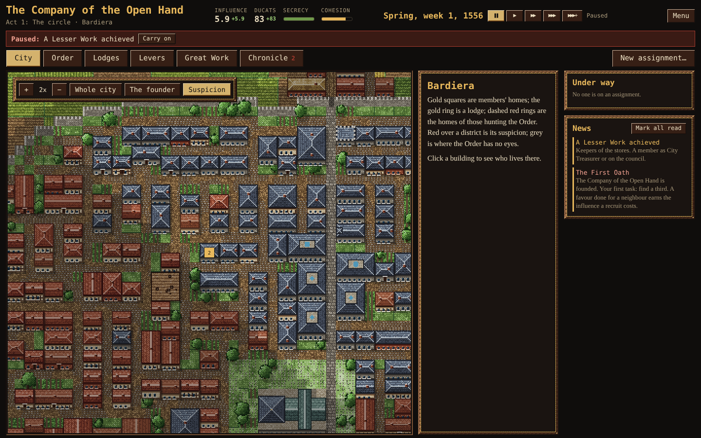

# The Hidden Hand

A story-generating strategy game in which you lead a secret society inside one simulated Renaissance port city,
over a few generations. Every one of the city's 4,000 to 8,000 people is simulated day by day, and nothing is
scripted: what happens comes from their needs, trades, families, faiths and grudges, and from what your Order does.

> **Status: playable, in development.** The one-city game is built end to end, from founding to the ending, and the
> app opens straight into it. Balance is still being tuned (some campaigns run very long without an ending), and
> breaks between acts are not finished yet. The earlier whole-world version (0.2.0) is no longer offered; its code is
> still in the repository, reachable by adding `#old` to the page address, until a later cleanup.



## The game

**The city.** An invented port, founded somewhere between 1500 and 1700, generated fresh for each campaign: walls,
districts, streets, workshops, churches, the harbour and every house, each with its rooms. Its people are born,
work, marry, quarrel, fall ill and die; a council, guilds and the church run it; prices, harvests, plague and crime
rise and fall on their own. A campaign covers about 60 to 90 years of it.

**Creed first.** A new game starts with the creed, not the founder. You see the city and its troubles, then shape
what the Order believes in one of three ways: take what the city seems to need, answer five questions, or set the
beliefs and vows yourself. The creed decides the **Great Work**. The game then offers three real people of the city
who could plausibly found such an Order, each with a companion, how strongly they already believe and how hard a
start they give. You name the Order and swear the First Oath.

**Winning.** Each Great Work is a real condition on the city, held for a number of years: no one starves, a school
in every district, a voice for the many on the council, peace in the streets, faith without fear, the hidden
council, or the city endures. Lesser works along the way reward the Order. Once the work has held, a member goes
**beyond the walls** to a neighbouring town to carry the Order on, and the campaign ends with a verdict on the
creed: kept **true**, **changed**, or **hollow**. You lose if the Order is destroyed, withers, or is left leaderless.

**What you work with:**

- **Members.** Recruit real people, shown with their belief, trust, grievances and rank, and the odds and risk of
  each approach. Members have zeal, discretion, standing and influence, and they age, waver, betray and die.
- **Assignments.** Who, what, at whom and how: scouting, recruiting, winning a seat, befriending, rumours, and the
  darker ones (blackmail, forgery, sabotage, poison, assassination). The elders give the odds, the risk, the days
  and the cost before anything is spent. Dark operations are shown in text only.
- **Levers.** Standing pulls through a member's seat, such as a granary law or opening the council. Each one is a
  contest against named opponents, with its forecast shown before you commit.
- **Lodges.** Hidden rooms in real buildings, from a back room to a cellar to a whole hidden house, drawn floor by
  floor, with rooms to build (safe room, vault, library, school, shrine, courier post).
- **Suspicion.** Every act leaves a trace. Suspicion builds per district, rumours spread by gossip, investigators
  open inquiries, and arrested members may name others. The map shows only what your members could know.
- **Conclaves** sit only when there is something to decide: a new leader, a traitor, a vacant seat, an amendment of
  the creed. The Order's posture (cautious, measured or bold) can be changed at any time.

**The clock.** One steady pace, about 20 seconds for a game week, with no fast-forward. Play and pause with the
button or the space bar. The game pauses by itself for anything that needs you and says why, and it autosaves once
a game year.

**The look.** Pixel art in the "Ledger + fronts" style: a dense top-down city with house fronts, earthy colours,
portraits for every person and a pixel frame around the interface. All of it is drawn by code, with no image files.

## Running it on Windows

**Option 1: no installation (recommended).** Download the repository (green *Code* button → *Download ZIP*),
unzip it, and double-click **`app\HiddenHand.html`**. It opens in your browser (Edge or Chrome recommended) and runs
entirely on your computer, with no server and no internet connection needed. Saved games are kept in the browser's
storage on your machine.

**Desktop app (optional).** For an installed program with a Start-menu shortcut, saves as real files in
`Documents\The Hidden Hand\Saves`, and no slow-down when the window is in the background, see
[`desktop/README.md`](desktop/README.md).

**Option 2: local server.** If your browser blocks pages opened from disk, install [Node.js](https://nodejs.org)
(version 18 or newer) and double-click **`HiddenHand.bat`**. It serves the app at `http://localhost:5179` and opens it.

**Option 3: from source** (for development):

```bat
npm install
npm run build        :: type-checks, builds dist/index.html and copies it to app/HiddenHand.html
npm start            :: serves the build at http://localhost:5179
npm run dev          :: live-reloading development server
npm run play         :: the game on its own page, live-reloading
npm run build:play   :: the game as one page, dist-play/play-page.html
```

## Developer tools

Balancing and testing run from the command line on the same engine:

```bat
npx tsx tools/order.ts 1-4 70 bot,passive,idle all   :: balancing: bot, passive and idle Orders over test campaigns
npx tsx tools/city.ts 1 90 3                         :: run a city for 90 years without the Order
npx tsx tools/citymap.ts 1                           :: a city's map as text
npm run art                                          :: the Art Lab, for the pixel renderer
npm test                                             :: automated tests
```

In the browser console, `hiddenHand` is the running game (`hiddenHand.advance(364)` runs a year straight through)
and `hiddenHandOpen(text)` opens a campaign saved as text.

The tools for the old whole-world simulation (`npm run sim`, `npm run experiment`, `npm run validate`,
`tools/campaigns.ts`) still run, but that simulation is no longer the game.

## Documentation

- [docs/PLAY.md](docs/PLAY.md): the game's screens, the clock and playtest hooks.
- [docs/CITY.md](docs/CITY.md): the city generator and the people simulation, and the 90-year gate.
- [docs/ORDER.md](docs/ORDER.md): the Order's rules: founding, operations, levers, suspicion, Great Works, conclaves.
- [docs/ART.md](docs/ART.md): the pixel renderer and the chosen style.
- Older, for the whole-world version: [docs/DESIGN.md](docs/DESIGN.md), [docs/GAME.md](docs/GAME.md),
  [docs/VALIDATION.md](docs/VALIDATION.md), [docs/EXPERIMENTS.md](docs/EXPERIMENTS.md).
