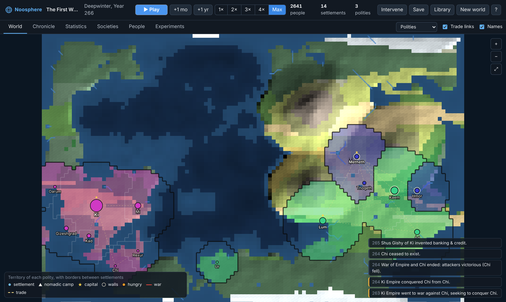

# The Hidden Hand

A story-generating strategy game in which you lead a secret society inside a fully autonomous, procedurally
generated civilisation. It is built on the simulation formerly called *The Noosphere*, and keeps all of it.

> **Status: in development.** The game layer described in the next section is being built now, toward a first
> milestone of a start screen, a tutorial and a single-player campaign. Until it lands, the app opens on the
> simulated world itself, which is what [Running it](#running-it-on-windows) and [Using it](#using-the-simulated-world)
> describe. Anything below that is not in the app yet is marked *(being built)* or *(planned)*. The full design of
> record is the design document *The Hidden Hand: game design*.

## The game

**Your seat.** You are neither king nor god. You play the continuing will of a hidden Order of real simulated
people, placed in courts, temples, guilds and schools. You command the Order directly; you never command the
world. Members carry out your orders with their own skill and character, and they age, waver, betray and die.
The world keeps its own mind: nothing is scripted, and every cause can be traced in the chronicle.

**Starting a campaign** *(being built)*. A world is generated and several centuries of history are simulated. The
game finds three real people at real moments where a secret society could plausibly begin (a scholar whose school
was closed, a granary keeper who watched a city starve), and you pick one or choose your own founder. Play opens at
the **First Oath**, the night the founder persuades a second person, in a short generated scene. The Order's
**name** and **creed** are assisted: take the founder's, answer five dilemmas, or write your own. The creed has a
direction on the simulation's five value axes and three vows, and it **evolves** with what the Order actually does
and with amendments at conclaves.

**Winning and losing.** Each campaign has a **Great Work** drawn from the creed, such as "no famine deaths among
your people for fifty years", achieved and then held for a set period, with three or four **Lesser Works** as
stepping stones. You lose if the Order is destroyed or if your people cease to exist as a people. A fallen Order is
game over. The balance target is that a competent player wins about one campaign in three.

**What you work with** *(being built)*:

- **Members, seats and cells.** Recruit real people, help them win real positions (treasurer, high priest, guild
  master, tutor to the heir), and group them into cells whose members know each other. Your reach is the seats
  you hold.
- **Four resources**, each tied to simulation state: **influence** (favours owed to a member in a seat, which dies
  with them), **wealth** (real coin in the conserved economy), **secrecy** (per city and per interest group) and
  **cohesion** (how far members still share the creed).
- **Levers**: slow, standing pressures applied through a seat, such as endowing a school, tilting the budget,
  counselling tolerance, backing a candidate, sponsoring a movement or chartering a trade route. A lever shifts a
  weight in other people's decisions; it never sets an outcome, and the groups it harms resist. Your strength is
  proportional to the scale you act at, every contested decision shows its tug of war, and the elders give a plain
  forecast before you commit.
- **Operations**: fast missions run by members you move along real roads and sea routes: recruit, scout, hide a
  member, persuade, and the darker ones (blackmail, forgery, sabotage, poison, assassination). Dark operations have
  two fixed limits, no sexual violence and nothing that singles out children, and are shown in text only.
- **Lodges and crafts.** Build hidden bases with rooms (safe rooms, vault, scriptorium, school, courier post,
  front), and develop the Order's own crafts (ciphers, tradecraft, forgery, medicine and more).
- **The Veil**, a core feature: you see only what your members could plausibly know. Every screen marks what is
  known, rumoured or unknown; the Order's own affairs are never hidden.
- **Resistance and exposure.** Interest groups (nobles, clergy, the military, merchants, guilds, scholars,
  farmers) push on government through the same pressures you do. Every action leaves a trace; suspicion builds per
  city and per group, real people become investigators, and a purge spreads along who knows whom.

**Pacing.** Continuous time, pausable at any moment, with three speeds (days, seasons, years) and automatic pauses
for anything that touches the Order. **Conclaves**, where the large decisions are made, come on an adaptive rhythm
(yearly at the founding, then every five and every ten years as the Order matures) or whenever you or the elders
call one. Later in a campaign you appoint **wardens** to run lodges to standing orders.

**Modes.** Tutorial (a guided first twenty years in a small fixed world) and the single-player campaign. These are
the only modes in the first milestone. The simulation's sandbox and experiment tools stay in the code for
development and balancing, off the menu (see [Developer mode](#developer-mode)).

**Planned for after the first milestone:** rival hidden hands and schisms, successive Orders in one world, the
archive and play through a dark age, fuller institutions and interest groups, selectable difficulty levels, an
optional "world without you" epilogue that re-runs history once after a campaign ends, scenarios and a read-only
legends mode. Re-running history is never part of play; during development it is only a balancing harness.

## The world underneath

A few hundred foragers are placed on a generated world, and from then on nothing is scripted: farming, towns,
markets, inequality, states, faiths, wars, inventions and collapses appear (or don't) because of the material
conditions and the choices of individually simulated people, now at the scale of whole peoples over centuries.
This is the engine the game runs on, and what the app shows today.



## Running it on Windows

**Option 1: no installation (recommended).** Download the repository (green *Code* button → *Download ZIP*),
unzip it, and double-click **`app\HiddenHand.html`**. It opens in your browser (Edge or Chrome recommended) and runs
entirely on your computer, with no server and no internet connection needed. Your saved worlds are kept in the
browser's storage on your machine.

**Desktop app (optional).** For an installed program with a Start-menu shortcut, saves as real files in
`Documents\The Hidden Hand\Saves`, and no slow-down when the window is in the background, see
[`desktop/README.md`](desktop/README.md).

**Option 2: local server.** If your browser blocks pages opened from disk, install [Node.js](https://nodejs.org)
(version 18 or newer) and double-click **`HiddenHand.bat`**. It serves the app at `http://localhost:5179` and opens it.

**Option 3: from source** (for development):

```bat
npm install
npm run build      :: type-checks, builds dist/index.html and copies it to app/HiddenHand.html
npm start          :: serves the build at http://localhost:5179
npm run dev        :: live-reloading development server
```

## Using the simulated world

Press **Space** to start. The top bar shows the date, controls and headline numbers; the tabs switch views.

| Tab | What it shows |
| --- | --- |
| **Story** | The front page. The current chapter of history, a plain-language summary of the state of the world, headlines, the realms with their rulers' portraits, the figures of the age, the chapters so far and the people you follow. |
| **World** | The living map. Forests thin and fields spread as people use the land, snow comes and goes with the seasons, caravans move along trade routes, armies march and fresh events ripple outward. Zoom in until settlements become towns; double-click one to open its streets. The strip under the map is the whole history: drag along it to see the world as recorded in any past year.  Choose a layer (polities, cultures, religions, terrain, forest, wild game, soil, farmland, rainfall, temperature). Drag to pan, scroll to zoom, click a settlement or patch of land to inspect it. Recent major events appear in the corner. |
| **Chronicle** | History divided into named chapters ("The Rise of Ki Empire", "The Plague Years"), each with a summary, then every recorded event, searchable and filterable by type, importance and date. Each has a *why* written from the state of the world at the time, and links to the events that caused it. |
| **Statistics** | Time series of population, births and deaths, fertility, food, hunger, inequality, wealth, trade, money, technology, literacy, unrest, wars, forests, game, soils, climate, occupations and causes of death. Export as CSV. |
| **Societies** | Timelines of polities, descent trees of cultures and faiths, technology discovery and diffusion, wars and epidemics. |
| **People** | Search the living and the notable dead, each with a portrait. |
| **Experiments** | *Developer mode only.* Design and run batches of worlds in the background, then analyse them. |

The **inspector** on the right links everything together: a settlement → its polity, residents, prices, buildings,
knowledge and history; a person → their family, character, values, memories, friends, rivals and deeds; an event →
its causes (as a tree) and its consequences. **Back** (or Esc) retraces your steps.

**Portraits, towns and family trees.** Every person has a portrait that is stable for life and ages with them. It is
drawn from the simulation: sex, age, culture (skin tone follows the climate of a culture's homeland), occupation, rank,
health and the technology of their home. A person's page opens their **family tree** and lets you **follow** them or
their dynasty. Every settlement has a **town view** drawn from its population, buildings, era, coast and river,
season, sieges and war damage; a slider replays its recorded growth. Street layouts and facial features are generated
from a fixed seed: they are decoration, not simulated detail.

**Alerts.** Major events pop up as cards. The world pauses itself for turning points: a new chapter, the first event of
its kind, or news of someone you follow. The bell in the top bar changes this. A short **guided tour** runs on first
launch and can be replayed from Help.

**Intervene** (developer mode only) applies a drought, plague, volcanic winter, climate shift, technology grant, bountiful years, migration
wave or cultural shock to the running world. **Save** (Ctrl+S) and **Library** keep worlds in the browser and export
or import them as files. A save resumes exactly: the same future unfolds as if you had never saved.
**New world** exposes every parameter of geography, environment, human nature and culture.

Keyboard: Space play/pause · `.` one month · `>` one year · `+`/`-` speed · `1`–`6` tabs (`7` in developer mode) · Ctrl+S save · Esc back.

## Developer mode

The simulation tools are off the player's menu but still in the app. Turn them on by opening
`app\HiddenHand.html?dev` (or `http://localhost:5179/?dev`), by starting the desktop app with `--dev` (or with the
environment variable `HIDDENHAND_DEV=1`), or by pressing **Ctrl+Shift+D**, which toggles them and remembers the
choice in that browser. A small *dev* badge by the title shows when they are on.

## Experiments (developer tools)

An experiment is a set of **conditions** (parameter changes and scheduled interventions) crossed with a set of
**seeds**. Two designs are available:

- **Fresh worlds**: each seed generates a new world. Seeds are shared across conditions (a paired design), so
  geography does not confound the comparison.
- **Branch from the current world**: every run continues the world you are watching with a different random future.
  This shows the spread of possible histories from one moment and how an intervention shifts it.

Runs execute in parallel background threads while you keep exploring. The results screen shows:

- **Findings** in plain language.
- **Trajectories**: the mean and 10th–90th percentile band of any metric over time, per condition.
- **Outcomes**: mean and 95% confidence interval per condition; versus the control, Cohen's d, Welch's t-test and
  the Mann–Whitney U test, with a Benjamini–Hochberg false-discovery correction across all outcomes. A difference is
  called *systematic* only if it survives the correction and is at least a medium effect; otherwise *suggestive* or
  *noise*. Hovering shows the confidence interval of the difference and how many runs would be needed to detect it.
- **When histories diverge**: the year after which a condition stays significantly different from the control.
- **What explains the differences between runs**: rank correlations of outcomes with each world's geography and
  with its early state.
- **Individual runs**, any of which can be reopened as a live world to see *how* it happened.

Reports export as Markdown, raw results as JSON. Ready-made experiments cover drought, aggression, soil fertility,
disease and fragmented geography. The same engine runs from the command line:

```bat
npm run experiment -- --preset drought --seeds 16 --years 250
npm run experiment -- --spec my-experiment.json
npm run sim -- --seed 3 --years 300          :: watch one world in the terminal
npm test                                      :: automated tests
npm run validate                              :: multi-seed validation → docs/VALIDATION.md
```

## Documentation

- [docs/DESIGN.md](docs/DESIGN.md): architecture and how each system works, including every major simplification.
- [docs/VALIDATION.md](docs/VALIDATION.md): results of the multi-seed validation battery.
- [docs/EXPERIMENTS.md](docs/EXPERIMENTS.md): writing experiment files and interpreting the statistics.
