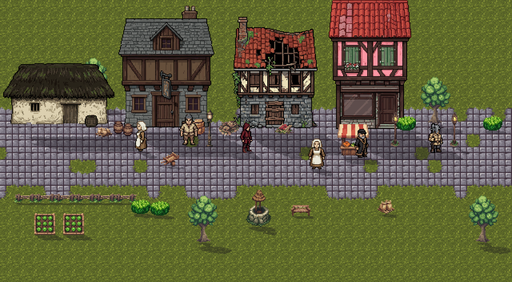
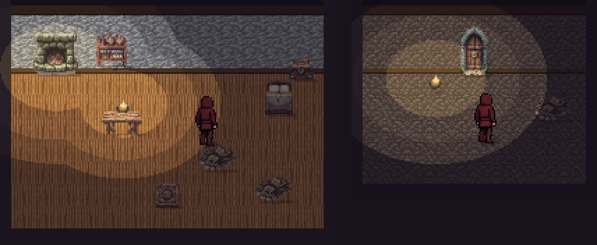

# Street art kit (first season)

This is the art library for the street view, the house interior and conversations. Ed generated it in Retro Diffusion on 16 Nov 2026. The hand-drawn and code-generated street art before it is superseded.

## Decisions

- **View:** front-on (Stardew-style). Building fronts face the camera and the roof is seen from slightly above. Not isometric.
- **Scale:** 16px ground tiles. Doors are about 29px tall. People are about 37px in a 32 x 40 frame, a little tall against the doors, which is accepted for now.
- **Light:** comes from the top left. Shadows fall down and to the right as hard, banded shapes with no soft blur.
- **Palette:** the Weathered Ledger palette (`src/ui/pixel/palette.ts`). The kit is not yet locked to it, but tests show it locks cleanly. The clock lighting lookup tables need locked colours, so lock at load time or in a build step.

## Files

Everything is under `src/assets/kit/`, and `kit.json` lists every asset with its size. Each kind of asset has its own folder and its own data in the manifest:

- **`buildings/`:** the inherited ruin, the inn, the rose townhouse, the thatched cottage, plus the wall tower and the gate. The canvas is 160 x 192. `base` is the row where the building meets the ground, so line that row up with the street edge.
- **`props/` and `interior/`:** single objects, each with `base` and `bbox`. Sort by base y for depth.
- **`tiles/`:** 16 x 16 tiles, plus `cobble-grass-wang`, a 64 x 80 corner tileset. Its layout is in `kit.json`. The corner key is TL, TR, BL, BR, where G is grass and s is stone. The tool `tools/kit/street_kit.py` shows how to pick a tile from vertex terrain.
- **`people/`:**
  - `*-walk.png` is a 3 x 3 sheet of 32 x 40 cells. Row 0 faces south (3 frames). Row 1 has west in column 0 and east in column 2. Row 2 faces north (3 frames). A `.gif` preview sits next to each sheet.
  - Single standing sprites have no suffix.
- **`portraits/`:** 64 x 64 head-and-shoulders portraits for conversations and the Book's Names pages.

## Known weak pieces (re-roll list in the art thread)

- **Plain tiles:** `cobble`, `paving` and `wall-plaster` come out as grey noise, and `mud` reads as bricks. The street uses the wang set instead.
- **Furniture size:** furniture is about half the size it should be next to people (bed, table, chest, shelves, junk, trapdoor).
- **Wall and gate:** `wall-tower` and `gate` don't join into a continuous town wall.

## Mock tools

`tools/kit/street_kit.py` and `tools/kit/interior_kit.py` (Python with PIL) build the two mock images above. They read Ed's original download names from the art thread's project folder, so treat them as reference for composition, shadows and banded candle light. They are not a build step.

## Licence

These assets were generated with Retro Diffusion. Check its terms on commercial use before release.
